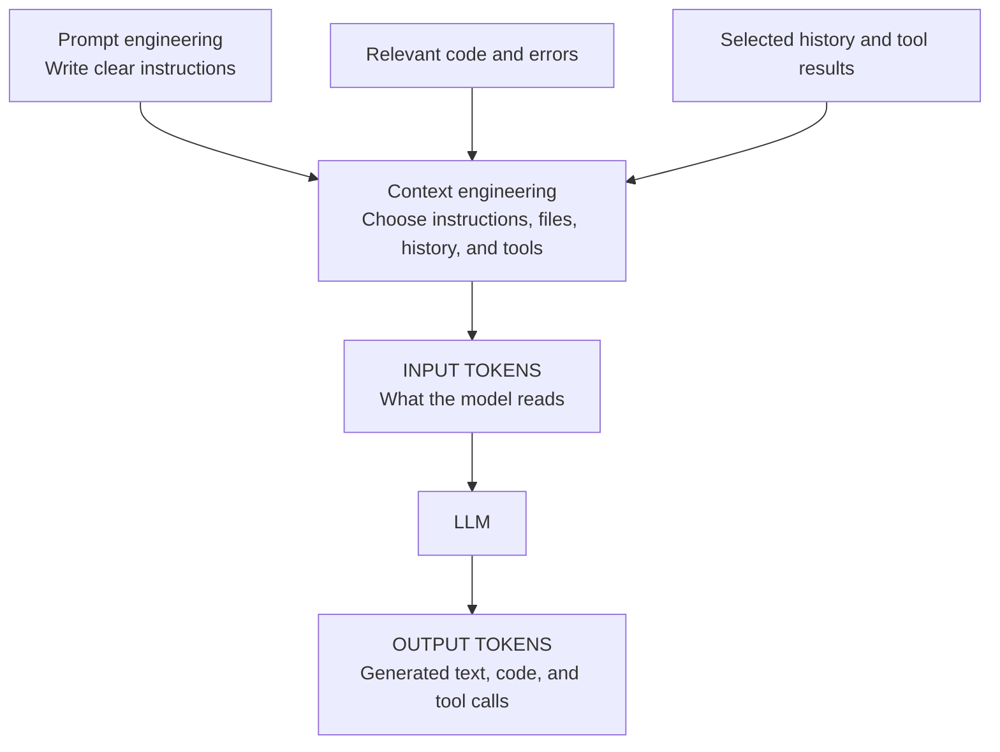
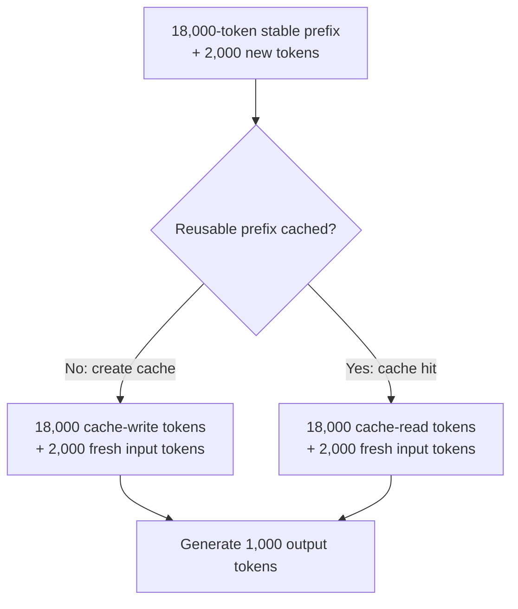
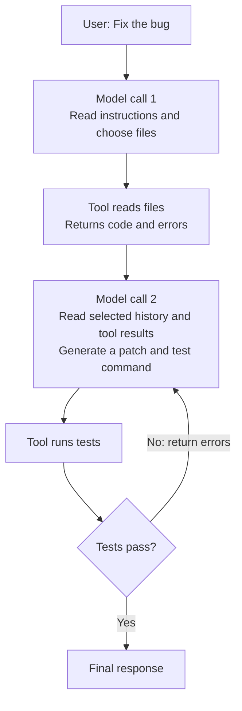
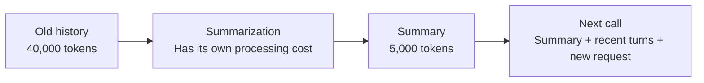

# LLM & Coding Agent Costs

## Start Here: See Your Daily Usage

Run these in a terminal with **Node.js and npm installed**, on the machine where you use the coding agents:

```bash
# Codex: usage and estimated cost for each day
npx ccusage@latest codex daily

# Claude Code: usage and estimated cost for each day
npx ccusage@latest claude daily

# Gemini CLI: usage and estimated cost for each day
npx ccusage@latest gemini daily

# Combined daily report for all supported agents detected locally
npx ccusage@latest daily

# Example: a date range, grouped into days in Indian Standard Time
npx ccusage@latest daily --since 20261001 --until 20261021 --timezone Asia/Kolkata
```

`npx` downloads and runs the package without a global install. **ccusage is a community tool** that reads saved local usage logs; see its [getting-started guide](https://ccusage.com/guide/), [Codex support](https://ccusage.com/guide/codex/), and [Gemini CLI support](https://ccusage.com/guide/gemini/). A machine with no retained agent logs cannot show past usage from elsewhere.

### Expected Output: Daily Reports

These **simplified sample reports use invented data and the teaching rates below**. Your dates, models, amounts, column layout, and rounding will differ. Each dated row summarizes that day's calls; the final row totals the selected period.

**Codex — `npx ccusage@latest codex daily`:**

```text
Daily Token Usage Report — Codex (illustrative)

┌────────────┬────────┬────────┬────────┬──────────────┬────────────┐
│ Date       │ Input  │ Cached │ Output │ Total Tokens │ Cost (USD) │
├────────────┼────────┼────────┼────────┼──────────────┼────────────┤
│ 2026-10-20 │ 20,000 │ 18,000 │  1,000 │       21,000 │    $0.0176 │
│ 2026-10-21 │ 40,000 │ 36,000 │  2,000 │       42,000 │    $0.0352 │
├────────────┼────────┼────────┼────────┼──────────────┼────────────┤
│ Total      │ 60,000 │ 54,000 │  3,000 │       63,000 │    $0.0528 │
└────────────┴────────┴────────┴────────┴──────────────┴────────────┘
```

Read the first row: **18,000 of the 20,000 input tokens are cached**, leaving **2,000 fresh input tokens**. Add 1,000 output tokens to get 21,000 total; do not add Cached a second time.

**Claude Code — `npx ccusage@latest claude daily`:**

```text
Daily Token Usage Report — Claude Code (illustrative)

┌────────────┬───────┬────────┬──────────────┬────────────┬──────────────┬────────────┐
│ Date       │ Input │ Output │ Cache Create │ Cache Read │ Total Tokens │ Cost (USD) │
├────────────┼───────┼────────┼──────────────┼────────────┼──────────────┼────────────┤
│ 2026-10-20 │ 2,000 │  1,000 │       18,000 │          0 │       21,000 │    $0.0590 │
│ 2026-10-21 │ 2,000 │  1,000 │            0 │     18,000 │       21,000 │    $0.0176 │
├────────────┼───────┼────────┼──────────────┼────────────┼──────────────┼────────────┤
│ Total      │ 4,000 │  2,000 │       18,000 │     18,000 │       42,000 │    $0.0766 │
└────────────┴───────┴────────┴──────────────┴────────────┴──────────────┴────────────┘
```

Here **Input is fresh input**, with cache creation and reads shown separately. Assume the cache is still valid for the second call, such as calls just before and after midnight. A cache hit makes this sample cheaper even though the total token count is the same. Widen the terminal if cache columns are hidden; see the [report-format guide](https://ccusage.com/guide/daily-reports).

### Read the Columns

Column names and visibility vary by source and terminal width. The [daily-report guide](https://ccusage.com/guide/daily-reports) explains the table:

| Column | What it means |
|--------|---------------|
| **Date** | The calendar day being summarized; `--timezone` controls day boundaries |
| **Agent / Models** | Which coding tool and models produced the usage |
| **Input** | Tokens read by the model: instructions, messages, code, and tool results |
| **Output** | Tokens generated by the model |
| **Cache Create / Write** | Input stored for later reuse, when recorded |
| **Cache Read / Cached** | Input reused from an existing cache |
| **Reasoning**, if shown | Internal thinking tokens; in the Codex report these are already part of output |
| **Total Tokens** | The report's total token usage, including repeated processing across calls |
| **Cost (USD)** | Estimated dollar value calculated from recorded usage and model rates |

**Do not add every column together:** depending on the source view, cached input or reasoning may already be included in another column. Use the reported total and source-specific definitions.

**An estimate is not your subscription bill.** Missing logs or pricing can make reports incomplete. Check your provider's account dashboard for actual charges and plan limits; [Codex's official billing guidance](https://learn.chatgpt.com/docs/pricing#token-rates) distinguishes subscription credits from API pricing.

## Try It Visually

Open the [interactive LLM token cost calculator](https://airside.llmgateway.io/tools/token-cost-calculator). It lets you change input, output, cached input, rates, and request volume without an API key.

**Two-minute experiment using our invented teaching rates:**

1. Enter **20,000 total input tokens**, **1,000 output tokens**, and **0 cached tokens**.
2. Set rates per million: **input $2**, **cached input $0.20**, **output $10**. Set the flat request charge to **$0**.
3. The per-request estimate is **$0.0500**. Change cached input to **18,000**: it becomes **$0.0176**.
4. Double the output to **2,000 tokens**: it becomes **$0.0276**. Notice that caching reduces input cost while output still costs money.

Cached input is a **subset of the 20,000 total**, so keep total input unchanged during step 3. This calculator excludes cache-write fees; the worked example below covers those separately.

To see what tokens look like, try [Tiktokenizer](https://tiktokenizer.vercel.app/): paste a sentence, a code snippet, or text in another language and compare token counts. Counts depend on the selected tokenizer; these tools do not measure your account's usage.

---

## What Makes Up the Cost?

You ask an agent to **“fix this bug.”** It reads files, writes code, runs tests, and tries again. The bill depends on everything the model processes and generates across those steps.

**Learning goal:** read a token bill, calculate a small example, and understand how prompting, context, caching, and compaction affect cost.

---

## 1. Prompt, Context, and Tokens

| Term | Beginner's meaning | Coding example |
|------|--------------------|----------------|
| **Prompt** | Instructions or a request sent to the model | “Fix this error and return a small patch.” |
| **Context** | All information available to the model for this call | Instructions + request + files + chat history + tool results |
| **Token** | A small unit the model processes; often part of a word | Text and code are split into tokens; tokens are not the same as words |
| **Context window** | The model's working capacity, measured in tokens | Input and generated output must fit the model's applicable limits |



- **Prompt engineering:** specify the task, constraints, examples, and desired output. Clear instructions can reduce retries and unnecessary output.
- **Context engineering:** decide what to include, retrieve, keep, or summarize on each call. Relevant context can reduce wasted reading and mistakes.
- **Caching and compaction** are techniques used when managing that context.

Example: “Fix the login bug; preserve the public API” improves the **prompt**. Including the failing test and relevant function improves the **context**. See [Anthropic's explanation of prompt and context engineering](https://www.anthropic.com/research/effective-context-engineering-for-ai-agents).

---

## 2. The Four Token Buckets

**All rates below are invented teaching rates in USD per 1 million tokens (MTok).** They are not a model price quote. Providers differ; use your chosen model's current pricing and usage records, such as [Claude's pricing documentation](https://platform.claude.com/docs/en/about-claude/pricing).

| Bucket | What you pay for | Example rate / MTok |
|--------|------------------|--------------------:|
| Fresh input | Input processed at the ordinary rate | $2.00 |
| Cache write | Input processed and stored for reuse, if separately priced | $2.50 |
| Cache read | Reusing already processed input | $0.20 |
| Output | Tokens generated by the model | $10.00 |

```text
Cost of a bucket = tokens ÷ 1,000,000 × its price per million

Call cost = fresh-input cost + cache-write cost
          + cache-read cost + output cost
```

**Count each input token in one bucket only.** If the API reports total input including cached input, subtract the cached portion before calculating fresh input. Other APIs report these buckets separately. Check the field definitions.

- Output may cost more per token than input, as it does in this example.
- Depending on the model, billed output can include reasoning tokens that are not shown in the final answer; see [thinking-token accounting](https://platform.claude.com/docs/en/build-with-claude/extended-thinking#budget-rules-and-tuning).
- A large context window is capacity; it does not mean you are charged for filling it when you send a short request.

---

## 3. Worked Example: Read 20,000 Tokens, Generate 1,000

Assume **18,000 tokens are stable project instructions/code** and **2,000 are new input**. Each call generates 1,000 output tokens.



| Situation | Input calculation | Output cost | Total |
|-----------|-------------------|------------:|------:|
| No caching | `20,000 / 1M × $2 = $0.0400` | $0.0100 | **$0.0500** |
| First call: cache write | `(18,000 × $2.50 + 2,000 × $2) / 1M = $0.0490` | $0.0100 | **$0.0590** |
| Later call: cache hit | `(18,000 × $0.20 + 2,000 × $2) / 1M = $0.0076` | $0.0100 | **$0.0176** |

For **10 identical-sized calls**, assuming one write and nine successful hits:

- Without caching: `10 × $0.0500 = $0.5000`.
- With caching: `$0.0590 + 9 × $0.0176 = $0.2174` — about **57% less overall**.

Caching reuses computation for a matching prompt prefix; the model still generates a new answer. It does **not** shorten the context or make output free. Keep stable material first and changing questions last. Minimum lengths, expiry, pricing, and invalidation rules vary; an expired or changed prefix may need processing again. See [prompt caching mechanics](https://platform.claude.com/docs/en/build-with-claude/prompt-caching) and the [Prompt Caching lesson](prompt-caching.md).

---

## 4. Why One Agent Task Can Mean Many Bills



- A generated tool call is model output; its returned file contents or test logs become input when included in the next call.
- Earlier answers can become later input too. A short “continue” can accompany a large retained history.
- Repeated calls, retries, and extra agents add usage. Tool services or execution environments may also charge separately.

```text
Task cost = sum of ALL model-call costs + separately billed tool/runtime fees
```

For example, 20 calls averaging `$0.0176` cost `$0.352` in model usage. Real calls usually have different token counts. A coding-tool subscription may bundle usage or apply credits and limits; this API calculation does not automatically describe its subscription bill.

---

## 5. “Compact” Means Shrink the History

**Compaction** replaces older conversation details with a shorter summary so work can continue with less active context. Keep the goal, constraints, decisions, changed files, and unresolved errors. See the [compaction overview](https://platform.claude.com/docs/en/build-with-claude/compaction).



**Illustrative calculation using our rates:** suppose a separate summarizer reads 40,000 fresh input tokens and generates a 5,000-token summary. Ignore unchanged instructions, new messages, caching, and tool fees in this comparison.

- Make summary: `(40,000 × $2 + 5,000 × $10) / 1M = $0.13`.
- Read old history on each future call: `40,000 × $2 / 1M = $0.08`.
- Read summary instead: `5,000 × $2 / 1M = $0.01`.
- Save **$0.07 per later call**; two later calls save `$0.14`, covering the `$0.13` summarization cost in this simplified case.

**Compaction is not an automatic discount.** Its billing depends on the implementation. It can change a cached prefix, require new cache writes, or lose details that must be read again. Cheap cached history can also cost less than an uncached summary. Include these effects before claiming savings; [Claude documents compaction usage separately](https://platform.claude.com/docs/en/build-with-claude/compaction-on-demand#count-compaction-usage).

| Technique | What changes? | Main benefit |
|-----------|---------------|--------------|
| Caching | Reuses processing of matching input | Lower processing cost for repeated content |
| Compaction | Replaces older detail with a shorter representation | Smaller active context and room to continue |

---

## 6. A Beginner's Cost Checklist

- **Be precise:** state the task, success condition, and desired output.
- **Select context:** send relevant files and error excerpts; retrieve more when needed.
- **Reuse stable prefixes:** check actual cache hits instead of assuming them.
- **Control loops:** inspect repeated failed attempts and set task budgets.
- **Compact thoughtfully:** preserve key facts and account for summarization and cache changes.
- **Measure completed work:** compare cost per successful task, including retries and tools.

**Quick check:** why can “try again” cost more than a long first question? Because the next call may also process retained instructions, files, previous responses, and tool results.

Continue with [Prompting — Foundations](01-prompt-engineering-1-foundations.md), [Context Engineering](context-engineering.md), and [AI Coding Assistants](ai-coding-assistants.md).
