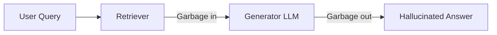
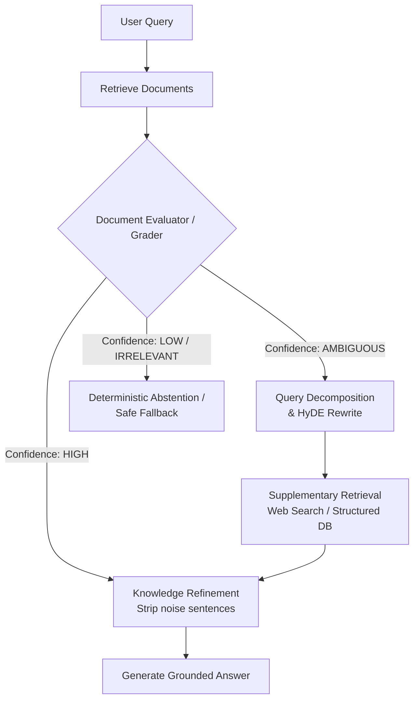

# Corrective & Agentic RAG: Closed-Loop Search & Grounding Firewalls

> Traditional RAG is an open-loop pipe: retrieve once, hope for the best, and feed whatever you found to an LLM. In control systems, open-loop pipelines fail whenever disturbances occur. Production RAG must be **closed-loop**.

---

## Why Open-Loop RAG Fails

In a standard RAG pipeline, the system has no feedback mechanism:



If the retriever fetches low-quality, misleading, or irrelevant chunks, the generator LLM is trapped. Even with strict instructions like *"only answer from context"*, models suffer from **sycophancy**—they try to please the user by piecing together an answer from irrelevant context fragments.

---

## The Closed-Loop Solution: Corrective RAG (CRAG)

**Corrective RAG (CRAG)** introduces an active **Evaluator** between retrieval and generation. Instead of blind acceptance, the system grades the quality of retrieved documents and branches dynamically:



### The Three Confidence States

| State | Evaluator Trigger | Action |
|---|---|---|
| **Correct** | Retrieved chunks directly and unambiguously answer the question | Strip irrelevant sentences from chunks (knowledge refinement), pass to generator |
| **Ambiguous** | Chunks are topically related but miss crucial facts | Rewrite query with HyDE (Hypothetical Document Embeddings), perform targeted secondary search |
| **Incorrect** | Chunks do not address the core question | Trigger fallback circuit breaker: apologize and declare knowledge boundary |

---

## The Hallucinated Citation Trap

Many teams believe they have solved grounding by adding this to their system prompt:

```text
"Answer using ONLY the provided chunks. Cite every fact using [CHUNK_N]."
```

### Why Prompt-Only Grounding Fails
1. **Misattribution:** The model writes: *"The database cluster was deployed in Frankfurt [CHUNK_2]"*, but `CHUNK_2` actually discusses the Singapore cluster.
2. **Fabricated Support:** The model generates a plausible answer from pre-training memory and randomly appends `[CHUNK_1]` to look authoritative.
3. **Cherry-Picked Truth:** The model quotes a clause while omitting an adjacent disqualifying condition.

### The Solution: A Grounding Firewall (Byte-Span Attribution)

A **Grounding Firewall** is a deterministic post-processing layer. It takes the LLM's generated response, parses each sentence, and mathematically verifies whether that sentence is supported by an exact or high-overlap text span in the retrieved chunks.

If an ungrounded claim is detected, the firewall:
1. Strips or flags the unverified claim
2. Downgrades the answer's confidence score
3. Appends an audit warning for human reviewers

---

## Production Implementation: Closed-Loop CRAG & Attribution Firewall

Here is an end-to-end, runnable Python implementation featuring document confidence grading, query rewriting, and deterministic byte-span citation verification:

```python
"""
corrective_rag_pipeline.py
Production-ready Closed-Loop Corrective RAG with Deterministic Grounding Firewall.
"""
from typing import List, Dict, Any, Tuple
import re

class CorrectiveRAGEngine:
    def __init__(self, high_confidence: float = 0.80, low_confidence: float = 0.60):
        self.high_conf = high_confidence
        self.low_conf = low_confidence

    def grade_retrieval(self, query: str, retrieved_chunks: List[Dict[str, Any]]) -> str:
        """
        Evaluate the quality of retrieved chunks.
        Returns: 'CORRECT', 'AMBIGUOUS', or 'INCORRECT'
        """
        if not retrieved_chunks:
            return "INCORRECT"

        top_score = max(c["score"] for c in retrieved_chunks)

        if top_score >= self.high_conf:
            return "CORRECT"
        elif top_score >= self.low_conf:
            return "AMBIGUOUS"
        else:
            return "INCORRECT"

    def rewrite_query_hyde(self, query: str) -> str:
        """
        Query transformation for ambiguous retrieval.
        Expands technical terms and strips conversational noise.
        """
        # Production would call a fast LLM; here is a deterministic heuristic rewriter:
        cleaned = re.sub(r'\b(can you|please|tell me about|how do i)\b', '', query, flags=re.I).strip()
        return f"{cleaned} specifications architecture parameters"

    def strip_irrelevant_sentences(self, query_terms: set, text: str) -> str:
        """
        Knowledge Refinement: Filter out noise sentences within a chunk
        before sending to the generation context window.
        """
        sentences = [s.strip() for s in re.split(r'(?<=[.!?])\s+', text) if s.strip()]
        relevant_sentences = []
        for s in sentences:
            s_words = set(re.findall(r'\w+', s.lower()))
            if s_words & query_terms:
                relevant_sentences.append(s)
        return " ".join(relevant_sentences) if relevant_sentences else text


class GroundingFirewall:
    """
    Deterministic Verification Layer:
    Mathematically validates that every generated claim exists in retrieved source text.
    """
    def __init__(self, min_token_overlap: float = 0.65):
        self.min_overlap = min_token_overlap

    def verify_citations(
        self,
        generated_sentences: List[str],
        source_chunks: Dict[str, str]
    ) -> List[Dict[str, Any]]:
        """
        Validates claim-to-chunk attribution.
        """
        verification_report = []

        for sentence in generated_sentences:
            # Extract claimed citation tag, e.g., [CHUNK_1]
            match = re.search(r'\[(CHUNK_\d+)\]', sentence)
            claim_text = re.sub(r'\[CHUNK_\d+\]', '', sentence).strip()

            if not match:
                verification_report.append({
                    "sentence": sentence,
                    "status": "UNGROUNDED_NO_CITATION",
                    "overlap_score": 0.0,
                    "verified": False
                })
                continue

            chunk_id = match.group(1)
            if chunk_id not in source_chunks:
                verification_report.append({
                    "sentence": sentence,
                    "status": "INVALID_CHUNK_REFERENCE",
                    "overlap_score": 0.0,
                    "verified": False
                })
                continue

            source_text = source_chunks[chunk_id].lower()
            claim_tokens = set(re.findall(r'\b\w{3,}\b', claim_text.lower()))

            if not claim_tokens:
                continue

            # Calculate token containment in source chunk
            matched_tokens = sum(1 for tok in claim_tokens if tok in source_text)
            overlap = matched_tokens / len(claim_tokens)

            is_verified = overlap >= self.min_overlap
            verification_report.append({
                "sentence": sentence,
                "claimed_chunk": chunk_id,
                "overlap_score": round(overlap, 3),
                "verified": is_verified,
                "status": "VERIFIED" if is_verified else "HALLUCINATED_ATTRIBUTION"
            })

        return verification_report


# --- Pipeline Execution Walkthrough ---
if __name__ == "__main__":
    crag = CorrectiveRAGEngine()
    firewall = GroundingFirewall(min_token_overlap=0.60)

    # 1. Scenario 1: High Confidence Retrieval (Grade: CORRECT)
    print("=== Scenario 1: High Confidence Retrieval (Grade: CORRECT) ===")
    user_query = "What port does Qdrant use for gRPC communication?"
    query_tokens = set(re.findall(r'\w+', user_query.lower()))

    retrieved_correct = [
        {"id": "CHUNK_1", "text": "Qdrant exposes HTTP on port 6333 and gRPC on port 6334 for high-throughput clients.", "score": 0.88},
        {"id": "CHUNK_2", "text": "Docker storage configuration uses volume mounts on local disk.", "score": 0.42}
    ]

    grade_1 = crag.grade_retrieval(user_query, retrieved_correct)
    print(f"Retrieval Grade: {grade_1}")

    if grade_1 == "CORRECT":
        # Knowledge Refinement
        refined_context = {
            c["id"]: crag.strip_irrelevant_sentences(query_tokens, c["text"])
            for c in retrieved_correct if c["score"] >= 0.70
        }
        print("Refined Context:", refined_context)

        # Simulated LLM Output with citations (one accurate, one fabricated)
        llm_sentences = [
            "Qdrant uses port 6334 for gRPC communication [CHUNK_1].",
            "Qdrant was founded in Berlin in 1995 [CHUNK_1]."  # False claim attributed to CHUNK_1!
        ]

        # Deterministic Grounding Firewall Check
        audit = firewall.verify_citations(llm_sentences, refined_context)
        print("\n--- Firewall Grounding Audit ---")
        for item in audit:
            flag = "✅ PASS" if item["verified"] else "❌ REJECT"
            print(f"{flag} ({item['status']}, overlap: {item['overlap_score']}): {item['sentence']}")

    # 2. Scenario 2: Ambiguous Retrieval (Grade: AMBIGUOUS)
    print("\n=== Scenario 2: Ambiguous Retrieval (Grade: AMBIGUOUS) ===")
    retrieved_ambiguous = [
        {"id": "CHUNK_3", "text": "Vector database communication protocols overview.", "score": 0.68}
    ]
    grade_2 = crag.grade_retrieval(user_query, retrieved_ambiguous)
    print(f"Retrieval Grade: {grade_2}")
    if grade_2 == "AMBIGUOUS":
        rewritten = crag.rewrite_query_hyde(user_query)
        print(f"Triggering HyDE Query Rewrite: '{user_query}' ➔ '{rewritten}'")
        print("Dispatched to secondary search index.")

    # 3. Scenario 3: Irrelevant Retrieval (Grade: INCORRECT)
    print("\n=== Scenario 3: Irrelevant Retrieval (Grade: INCORRECT) ===")
    retrieved_incorrect = [
        {"id": "CHUNK_4", "text": "Instructions for baking sourdough bread.", "score": 0.28}
    ]
    grade_3 = crag.grade_retrieval(user_query, retrieved_incorrect)
    print(f"Retrieval Grade: {grade_3}")
    if grade_3 == "INCORRECT":
        print("Fallback Triggered: Knowledge boundary reached. Safely abstaining.")
```

---

## When to Use Which Architecture

```text
Complexity & Latency Spectrum:

Naive RAG (Single-shot)
  │  Fastest (100–300ms)
  │  Best for: Simple FAQs, non-critical conversational search
  ▼
Reranked Hybrid RAG (BM25 + Dense + Cross-Encoder)
  │  Balanced (300–600ms)
  │  Best for: Enterprise documentation, code search, knowledge bases
  ▼
Corrective RAG + Grounding Firewall (CRAG)
  │  High Precision (600–1500ms)
  │  Best for: Compliance, medical/legal queries, financial audits, customer billing
```

---

## Real-World Takeaways

1. **LLMs are eager to please:** If you feed an LLM irrelevant chunks, it will try to weave them into an answer instead of saying "I don't know."
2. **Grade before you generate:** An active evaluation step prevents garbage-in, garbage-out.
3. **Never trust self-reported citations:** LLMs cannot accurately check their own citations. Use a deterministic overlap verifier to guarantee that claims match source spans before shipping responses to customers.
