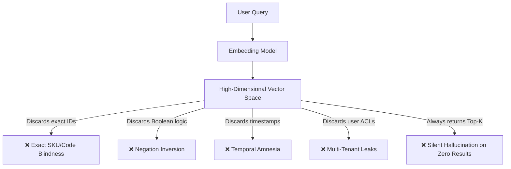

# Production RAG: What LLMs Can't Do & The 7 Deadly Breakpoints

> Anyone can build a 10-line RAG prototype that impresses on 3 clean PDFs. In production, 80% of naive RAG systems fail within 30 days. Here is what vector search and LLMs fundamentally cannot do—and how enterprise systems survive.

---

## The Vector Search Fallacy

When beginners learn RAG, the mental model is deceptively simple:

```text
Query → Embed → Vector DB (Cosine Top-K) → Stuff Chunks into LLM → Perfect Answer
```

In 2026, any coding assistant or LLM can write that Chroma or FAISS boilerplate in 5 seconds. But in production, this naive open-loop pipeline breaks constantly.

**Why?** Because dense embeddings are **topical proximity approximations**, not logical reasoners, access controllers, or exact filters. Embedding a document turns complex structured semantics into a single high-dimensional point.

When you collapse information into vector space, you discard:
1. Exact identifiers and lexical syntax
2. Propositional logic and negations
3. Temporal validity and currency
4. Access control and tenancy boundaries



---

## The 7 Deadly Production Breakpoints

### 1. Exact Identifier & SKU Blindness
- **The Failure:** A user asks: *"What is the warranty policy for product SKU-90412-B?"*
- **What Vector Search Does:** It embeds `SKU-90412-B`. The vector space places `SKU-90412-A`, `SKU-90412-B`, and `SKU-90412-C` at 0.992 cosine similarity because they share 99% identical textual context.
- **The Disaster:** The retriever pulls `SKU-90412-A` (which has a 1-year warranty), while `SKU-90412-B` has a 5-year warranty. The LLM confidently gives the wrong legal guarantee.
- **Production Fix:** **Hybrid Token-Exact Routing**. Route queries with alphanumeric codes, IDs, error numbers, or legal clauses through BM25 / PostgreSQL full-text search with strict token filters, bypassing or overriding dense similarity.

### 2. Negation & Quantifier Inversion
- **The Failure:** *"Find vendor contracts that do NOT include an automatic price escalation clause."*
- **What Vector Search Does:** Cosine similarity measures *topical overlap*. Both the query and the target documents are heavily weighted on "vendor contract", "automatic price escalation", and "clause". Chunks that explicitly contain "automatic price escalation clause" receive the *highest* similarity score!
- **The Disaster:** The retriever returns contracts that *have* the clause, and the LLM synthesizes an answer that completely inverts the business requirement.
- **Production Fix:** **Propositional Pre-Query Filtering**. Parse negation and constraint filters before search, or use an LLM-based query decomposer to extract metadata predicates (`has_price_escalation: false`).

### 3. Temporal Amnesia & Semantic Staleness
- **The Failure:** *"What is our current travel reimbursement limit for meals?"*
- **What Vector Search Does:** The corporate wiki has a comprehensive 50-page PDF from 2022 explaining the $75 meal allowance in rich detail with examples. In October 2026, HR sent a 2-sentence Slack memo updating it to $100. Dense embeddings favor the long, rich 2022 PDF over the sparse 2026 update.
- **The Disaster:** The model confidently cites the outdated 2022 policy.
- **Production Fix:** **Temporal Recency Decay & Version Partitioning**. Vector DB queries must enforce hard metadata filters (`valid_to: null` or `superseded: false`) or apply exponential time-decay scoring:

$$\text{Final Score} = \text{Score}_{\text{semantic}} \times e^{-\lambda (t_{\text{now}} - t_{\text{doc}})}$$

### 4. Silent False Retrieval (The Zero-Result Trap)
- **The Failure:** A user asks about a policy or product that does not exist in the database: *"How do I claim paternity leave during the probationary period?"* (When probation leave is not covered anywhere).
- **What Vector Search Does:** Vector search is an algorithm for *k-Nearest Neighbors*. It **never** returns empty! It will dutifully return the 3 closest chunks, even if the distance is 0.72 (pure irrelevance).
- **The Disaster:** The LLM receives 3 chunks about standard paternity leave and general probation rules. Due to model sycophancy, it hallucinates a plausible-sounding compromise policy that doesn't exist.
- **Production Fix:** **Calibrated Distance Thresholds & The Abstention Circuit Breaker**. If `max(similarity_scores) < threshold`, trip a circuit breaker immediately: do not call the generator; return a verified *"No authoritative documentation found"* response.

### 5. Multi-Tenant Authorization & ACL Leaks
- **The Failure:** User Alice (junior intern) asks: *"What was the rationale for last quarter's bonus allocations?"*
- **What Vector Search Does:** The vector database searches the entire shared index. Alice's query matches an executive compensation memo embedded last week.
- **The Disaster:** Alice gets confidential executive compensation data. Even if the LLM is told "don't disclose secrets," the retrieved text in its context window leaks directly.
- **Production Fix:** **Cryptographic / Row-Level Security Pre-Filtering**. Never query the vector index globally. Enforce ACLs at the database query engine before nearest-neighbor calculation:

```python
query_filter = {
    "must": [
        {"key": "tenant_id", "match": {"value": user.org_id}},
        {"key": "allowed_roles", "match": {"any": user.roles}}
    ]
}
```

### 6. Context Window Poisoning & "Lost in the Middle"
- **The Failure:** Developers assume: *"Our model has a 128k context window, so let's just retrieve Top-30 chunks to be safe!"*
- **The Reality:** Needle-in-a-haystack benchmarks prove that when an LLM is flooded with 30 chunks, distractors degrade reasoning accuracy by up to 35%. Furthermore, latency increases 5x, and cost explodes.
- **Production Fix:** **Cross-Encoder Reranking & Compression**. Retrieve Top-25 with fast bi-encoder + BM25, rerank with a cross-encoder (e.g. Cohere or BGE-Reranker-v2), and pass only the Top-3 to Top-5 highest-scoring chunks to the generator.

### 7. Chunk Boundary Amputation
- **The Failure:** A naive splitter cuts text at 500 characters:
  - **Chunk 1:** *"The customer is entitled to a full refund within 30 days of purchase..."*
  - **Chunk 2:** *"...provided that the item has not been unboxed and proof of purchase is uploaded."*
- **What Happens:** Chunk 1 is retrieved. The condition in Chunk 2 is lost.
- **Production Fix:** **Hierarchical / Parent-Child Chunking** or **Late Chunking**. Small chunks for vector indexing; full parent sections for LLM context.

---

## Production Gatekeeper: Hands-On Implementation

Here is a production-grade pre-retrieval classifier and confidence gatekeeper that prevents silent hallucinations and enforces multi-tenant isolation:

```python
"""
production_rag_guard.py
A production-grade pre-retrieval gatekeeper and abstention circuit breaker.
"""
import re
from typing import List, Dict, Any, Optional
from dataclasses import dataclass

@dataclass
class UserSession:
    user_id: str
    tenant_id: str
    roles: List[str]

@dataclass
class RetrievedChunk:
    chunk_id: str
    text: str
    score: float
    metadata: Dict[str, Any]

class ProductionRAGGuard:
    def __init__(self, min_similarity_threshold: float = 0.75):
        self.min_similarity = min_similarity_threshold
        # Regex to detect exact identifiers (SKUs, UUIDs, ticket numbers, error codes)
        self.id_pattern = re.compile(r'\b([A-Z]{2,}-\d{3,}|\bERR-\d{3,}|\b[a-f0-9]{8}\b)\b', re.IGNORECASE)

    def analyze_query_intent(self, query: str) -> Dict[str, Any]:
        """
        Determine if query requires exact token search or has negation.
        LLMs struggle with these; routing rules catch them deterministically.
        """
        has_id = bool(self.id_pattern.search(query))
        has_negation = bool(re.search(r'\b(not|never|without|exclude|except|none)\b', query, re.IGNORECASE))
        has_temporal = bool(re.search(r'\b(latest|current|recent|2026|new|updated)\b', query, re.IGNORECASE))

        return {
            "query": query,
            "requires_exact_lexical": has_id,
            "has_negation": has_negation,
            "is_time_sensitive": has_temporal,
            "detected_identifiers": self.id_pattern.findall(query)
        }

    def build_security_filter(self, session: UserSession) -> Dict[str, Any]:
        """
        Enforce Row-Level Security (RLS) in vector database payload queries.
        Prevents unauthorized chunk leakage BEFORE similarity computation.
        """
        return {
            "must": [
                {"key": "tenant_id", "match": {"value": session.tenant_id}},
                {"key": "allowed_roles", "match": {"any": session.roles}},
                {"key": "is_superseded", "match": {"value": False}}
            ]
        }

    def evaluate_retrieval_confidence(
        self,
        chunks: List[RetrievedChunk],
        intent: Dict[str, Any]
    ) -> Dict[str, Any]:
        """
        Abstention Circuit Breaker:
        Decide whether to proceed to generation or refuse safely.
        """
        if not chunks:
            return {
                "decision": "ABSTAIN",
                "reason": "No matching documents found in your access scope.",
                "safe_chunks": []
            }

        top_score = max(c.score for c in chunks)

        # Failure Mode 4: Zero-Result Trap (top chunk is below confidence threshold)
        if top_score < self.min_similarity:
            return {
                "decision": "ABSTAIN",
                "reason": f"Top match score ({top_score:.2f}) is below confidence threshold ({self.min_similarity:.2f}).",
                "safe_chunks": []
            }

        # Failure Mode 1: Exact ID mismatch
        if intent["requires_exact_lexical"]:
            required_ids = set(i.lower() for i in intent["detected_identifiers"])
            matched_chunks = []
            for c in chunks:
                chunk_text_lower = c.text.lower()
                if any(req_id in chunk_text_lower for req_id in required_ids):
                    if c.score >= self.min_similarity:
                        matched_chunks.append(c)

            if not matched_chunks:
                return {
                    "decision": "ABSTAIN",
                    "reason": f"Semantic matches found, but none contained the exact required ID {required_ids} with score >= {self.min_similarity:.2f}.",
                    "safe_chunks": []
                }
            return {
                "decision": "PROCEED",
                "safe_chunks": matched_chunks[:3]
            }

        safe_chunks = [c for c in chunks if c.score >= self.min_similarity]
        return {
            "decision": "PROCEED",
            "safe_chunks": safe_chunks[:5]
        }


# --- Interactive Verification ---
if __name__ == "__main__":
    guard = ProductionRAGGuard(min_similarity_threshold=0.75)
    alice = UserSession(user_id="u_101", tenant_id="org_acme", roles=["analyst"])

    # Test 1: Query with missing SKU in retrieved docs
    print("=== Test 1: Exact SKU Missing from Retrievable Results ===")
    query1 = "Check warranty for SKU-88492"
    intent1 = guard.analyze_query_intent(query1)
    print("Intent Analysis:", intent1)

    mock_chunks1 = [
        RetrievedChunk("c1", "General warranty rules for electronics.", score=0.82, metadata={"tenant_id": "org_acme"}),
        RetrievedChunk("c2", "Replacement guide for SKU-11002.", score=0.79, metadata={"tenant_id": "org_acme"})
    ]

    gate1 = guard.evaluate_retrieval_confidence(mock_chunks1, intent1)
    print("Gate Decision:", gate1["decision"])
    print("Reason:", gate1["reason"])

    # Test 2: Query with exact matching SKU and high confidence
    print("\n=== Test 2: Exact SKU Found with High Confidence ===")
    mock_chunks2 = [
        RetrievedChunk("c3", "SKU-88492 includes a 3-year enterprise replacement warranty.", score=0.89, metadata={"tenant_id": "org_acme"})
    ]
    gate2 = guard.evaluate_retrieval_confidence(mock_chunks2, intent1)
    print("Gate Decision:", gate2["decision"])
    print("Safe chunks:", [c.chunk_id for c in gate2["safe_chunks"]])

    # Test 3: Generic query where all matches are below confidence threshold
    print("\n=== Test 3: Zero-Result Trap (Low Confidence Cutoff) ===")
    query3 = "What is the policy for deep sea robotic salvage insurance?"
    intent3 = guard.analyze_query_intent(query3)
    mock_chunks3 = [
        RetrievedChunk("c4", "Standard marine shipping cargo coverage.", score=0.52, metadata={"tenant_id": "org_acme"})
    ]
    gate3 = guard.evaluate_retrieval_confidence(mock_chunks3, intent3)
    print("Gate Decision:", gate3["decision"])
    print("Reason:", gate3["reason"])
```

---

## Production RAG Architecture Matrix

| Production Challenge | Why Vector Search Fails | Production Solution | Latency Impact |
|---|---|---|---|
| **Product Codes / SKUs** | High-dimensional clustering treats strings with similar prefixes as synonyms | Token-exact BM25 / PostgreSQL filter | < 5ms |
| **Outdated Info** | Older, longer documents dominate dense cosine scores | Temporal decay scoring + version flags | < 2ms |
| **Missing Knowledge** | k-NN algorithm always returns top-k nearest neighbors | Calibrated distance cutoff (< 0.75) | 0ms |
| **Multi-Tenancy** | Vectors carry no authorization context | Mandatory pre-filtering on tenant/role metadata | 5–15ms |
| **Logic & Negation** | Embeddings encode topics, not Boolean logic operators | Intent router with structured query decomposition | 50–150ms |
| **Distractor Chunks** | Feeding 20 chunks degrades reasoning ("Lost in the Middle") | Cross-encoder reranker down to top 3–5 chunks | 60–120ms |

---

## Checklist for Production RAG

- [ ] **Never perform unbounded global ANN search:** Always pre-filter by `tenant_id` and user permissions.
- [ ] **Install a similarity threshold cut-off:** Do not pass chunks with similarity below 0.70–0.75 to the generator.
- [ ] **Extract exact identifiers:** If a query contains a ticket ID, part number, or error code, require lexical match verification.
- [ ] **Rerank before prompting:** Never pass raw top-20 vector search results directly to an LLM. Rerank down to top 3–5.
- [ ] **Log silent abstentions:** Measure how often the circuit breaker triggers to discover gaps in your documentation corpus.
