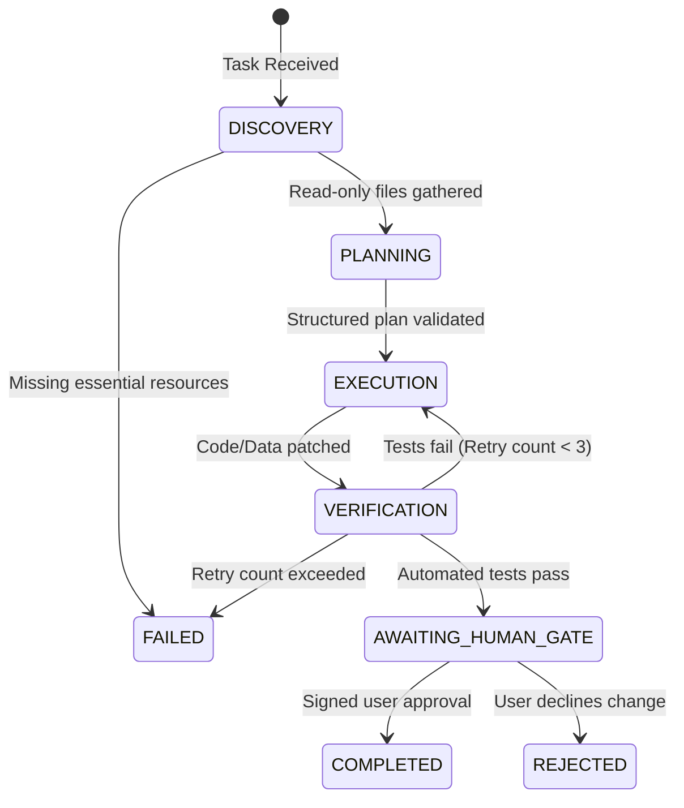
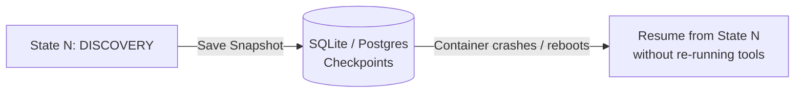

# Deterministic State Machines & Hybrid Agent Architecture

> The secret of enterprise-grade AI agents—from software engineering assistants like Claude Code and Devin to automated finance workflows—is simple: **they are not open-ended while-loops. They are deterministic Finite State Machines (FSMs) where LLMs act only as scoped transition engines.**

---

## The Illusion of the Free ReAct Loop

In 2026, most tutorials teach students the basic ReAct loop:

```python
# The Naive Prototype (DO NOT USE IN PRODUCTION)
while not done:
    action = llm.choose_tool(all_available_tools)
    result = execute(action)
    done = check_if_done(result)
```

### Why This Architecture Fails in Production
1. **Unbounded Tool Surface:** In turn 1, while still exploring the codebase, the model might spontaneously call `git push --force` or `drop_database()`.
2. **No Checkpointing:** If the network blips at step 14, the entire process crashes. All intermediate state and API spend are lost.
3. **Flaky Halting:** The model decides when it is "done", often stopping prematurely before tests run or looping indefinitely.

---

## The Hybrid Architecture: State Machines + LLMs

In a **Hybrid Agent Architecture**, deterministic Python code controls the workflow, the transition rules, and the tool permissions. The LLM is only called inside specific states to perform reasoning or generate structured inputs for authorized tools.



### Scoped Tool Permissions by State

| State | Allowed Tools | Forbidden Tools |
|---|---|---|
| `DISCOVERY` | `read_file`, `grep_search`, `list_directory` | `write_file`, `git_commit`, `run_bash` |
| `PLANNING` | *None* (pure reasoning & schema validation) | All side-effecting tools |
| `EXECUTION` | `edit_file`, `write_file`, `create_branch` | `git_push`, `delete_table` |
| `VERIFICATION` | `run_pytest`, `type_check`, `linter` | All mutating tools |
| `APPROVAL` | *None* (system paused awaiting external human token) | All tools |

By restricting tool availability by state, **it is mathematically impossible for an agent in the `DISCOVERY` state to overwrite files or mutate production environments.**

---

## Checkpointing & Resumability

Real agent workflows can take minutes or hours. In cloud environments, worker pods get preempted, rate limits trigger exponential backoff, and users close their laptops.

A production agent must be **state-serialized to disk or a database on every transition**:



---

## True Human-in-the-Loop (HITL)

Never rely on a prompt instruction like: *"Please ask the user for confirmation before deleting anything."* Models routinely ignore this when following a confident chain of thought.

**True HITL is an architectural suspension point:**
1. The state machine transitions to `AWAITING_HUMAN_GATE`.
2. The agent yields execution, writing an approval ticket to the database with a diff and an authorization hash.
3. The process exits or goes to sleep.
4. Only when a human signs the approval token via an API endpoint or UI does the state machine transition into `COMMITTING_CHANGES`.

---

## Production Implementation: Persistent State Machine Agent

Here is a complete, runnable Python implementation featuring typed states, transition gates, SQLite checkpointing, and resumability:

```python
"""
hybrid_fsm_agent.py
A production-ready Finite State Machine agent with SQLite persistence and HITL approval.
"""
import sqlite3
import json
import uuid
from enum import Enum
from typing import Dict, Any, Optional

class AgentState(str, Enum):
    INIT = "INIT"
    DISCOVERY = "DISCOVERY"
    EXECUTION = "EXECUTION"
    VERIFICATION = "VERIFICATION"
    AWAITING_APPROVAL = "AWAITING_APPROVAL"
    COMPLETED = "COMPLETED"
    FAILED = "FAILED"

class CheckpointStore:
    def __init__(self, db_path: str = "agent_state.db"):
        self.conn = sqlite3.connect(db_path)
        self.create_tables()

    def create_tables(self):
        with self.conn:
            self.conn.execute("""
                CREATE TABLE IF NOT EXISTS checkpoints (
                    run_id TEXT PRIMARY KEY,
                    state TEXT NOT NULL,
                    context_json TEXT NOT NULL,
                    step_count INTEGER NOT NULL,
                    updated_at TIMESTAMP DEFAULT CURRENT_TIMESTAMP
                )
            """)

    def save(self, run_id: str, state: AgentState, context: Dict[str, Any], step_count: int):
        with self.conn:
            self.conn.execute("""
                INSERT INTO checkpoints (run_id, state, context_json, step_count)
                VALUES (?, ?, ?, ?)
                ON CONFLICT(run_id) DO UPDATE SET
                    state = excluded.state,
                    context_json = excluded.context_json,
                    step_count = excluded.step_count,
                    updated_at = CURRENT_TIMESTAMP
            """, (run_id, state.value, json.dumps(context), step_count))

    def load(self, run_id: str) -> Optional[Dict[str, Any]]:
        cursor = self.conn.execute(
            "SELECT state, context_json, step_count FROM checkpoints WHERE run_id = ?",
            (run_id,)
        )
        row = cursor.fetchone()
        if not row:
            return None
        return {
            "state": AgentState(row[0]),
            "context": json.loads(row[1]),
            "step_count": row[2]
        }


class HybridFSMAgent:
    def __init__(self, run_id: Optional[str] = None, store: Optional[CheckpointStore] = None):
        self.store = store or CheckpointStore(":memory:")
        self.run_id = run_id or f"run-{uuid.uuid4().hex[:8]}"
        
        # Load existing state or initialize fresh
        saved = self.store.load(self.run_id)
        if saved:
            self.state = saved["state"]
            self.context = saved["context"]
            self.step_count = saved["step_count"]
            print(f"[RECOVERED] Resumed run {self.run_id} at state '{self.state.value}' (step {self.step_count})")
        else:
            self.state = AgentState.INIT
            self.context = {"discovered_files": [], "edits": [], "test_passed": False}
            self.step_count = 0
            self._save_checkpoint()

    def _save_checkpoint(self):
        self.store.save(self.run_id, self.state, self.context, self.step_count)

    def transition_to(self, new_state: AgentState):
        print(f"[FSM] Transitioning: {self.state.value} ➔ {new_state.value}")
        self.state = new_state
        self.step_count += 1
        self._save_checkpoint()

    def run_step(self, user_approval_token: Optional[str] = None):
        """Execute one step of the state machine."""
        if self.state == AgentState.INIT:
            # Transition to discovery
            self.transition_to(AgentState.DISCOVERY)

        elif self.state == AgentState.DISCOVERY:
            # Read-only exploration. Only read tools allowed here.
            print(" -> [DISCOVERY] Gathering project files safely (Read-Only)...")
            self.context["discovered_files"] = ["auth.py", "tests/test_auth.py"]
            self.transition_to(AgentState.EXECUTION)

        elif self.state == AgentState.EXECUTION:
            # Modify files
            print(" -> [EXECUTION] Applying isolated patch to auth.py...")
            self.context["edits"].append("Added token expiry validation")
            self.transition_to(AgentState.VERIFICATION)

        elif self.state == AgentState.VERIFICATION:
            # Run deterministic automated tests
            print(" -> [VERIFICATION] Executing automated pytest suite...")
            tests_ok = True  # Simulated test run
            self.context["test_passed"] = tests_ok

            if tests_ok:
                self.transition_to(AgentState.AWAITING_APPROVAL)
            else:
                self.transition_to(AgentState.FAILED)

        elif self.state == AgentState.AWAITING_APPROVAL:
            # Architectural Human Gate: Cannot proceed without cryptographically signed token
            if user_approval_token == "APPROVE_RELEASE_2026":
                print(" -> [HUMAN_GATE] Verified human cryptographic token!")
                self.transition_to(AgentState.COMPLETED)
            else:
                print(" -> [HUMAN_GATE] Execution SUSPENDED. Waiting for human approval token.")
                return "SUSPENDED"

        elif self.state in (AgentState.COMPLETED, AgentState.FAILED):
            print(f"[FINISHED] Agent terminated with status: {self.state.value}")
            return "DONE"

        return "CONTINUE"


# --- Interactive Verification & Crash Recovery Walkthrough ---
if __name__ == "__main__":
    shared_db = CheckpointStore(":memory:")
    run_token = "task-session-42"

    print("=== Phase 1: Agent starts execution until Human Gate ===")
    agent = HybridFSMAgent(run_id=run_token, store=shared_db)
    while True:
        status = agent.run_step()
        if status in ("SUSPENDED", "DONE"):
            break

    print("\n=== Phase 2: Simulating Process Crash / Server Restart ===")
    # Creating a new agent instance pointing to the same run_id simulates reboot
    rebooted_agent = HybridFSMAgent(run_id=run_token, store=shared_db)

    print("\n=== Phase 3: Supplying Human Approval to Resumed Agent ===")
    while True:
        status = rebooted_agent.run_step(user_approval_token="APPROVE_RELEASE_2026")
        if status == "DONE":
            break
```

---

## Architectural Comparison

```text
Free ReAct Loop:
  [Any Tool] ⟵⟮Chaotic Jump⟯⟶ [Any Tool] ⟵⟮Prompt Hallucination⟯⟶ [Unchecked Side Effects]

Hybrid State Machine:
  [INIT] ➔ [DISCOVERY (Read-only)] ➔ [EXECUTION] ➔ [VERIFY (Tests)] ➔ [GATE (Human)] ➔ [DONE]
              │
          (Checkpoint to SQLite on every arrow)
```

---

## Production Rules for Agent Architects

1. **State determines tools:** Never expose write/delete tools in an exploratory or discovery state.
2. **Deterministic halting:** Never trust the model to declare "I'm done." The state machine transitions to `COMPLETED` only when automated verification (lint, type check, test suite) produces passing exit codes.
3. **Resilience by default:** Every state transition must be a committed database transaction. If the host environment dies, resumption is instant and deterministic.
